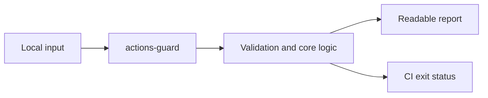

# actions-guard

<div align="center">
  
  <br/>
  
  
  
</div>

> Audit GitHub Actions workflow files for risky permissions, unpinned actions, and common trust-boundary mistakes.

## Why it exists

A focused, inspectable starter for a real developer workflow. It favors explicit behavior, local execution, and small pieces that are easy to understand and extend.

## Features

- Finds missing explicit permissions blocks
- Flags third-party actions not pinned to full commit SHAs
- Warns about pull_request_target and persisted checkout credentials
- Supports a single workflow file or a workflow directory

## Architecture



## Requirements

- Python 3.10+ / standard library
- A terminal and a local checkout of this repository

## Quick start

```bash
python src/actions_guard.py .github/workflows/
```

## Example

```bash
python src/actions_guard.py .github/workflows/build.yml
```

## Project status and limitations

This repository contains an initial working implementation, not a production-certified product. Review the source and test it against your own fixtures before adopting it in critical workflows.

This is a lightweight text-based audit, not a complete YAML parser. Review workflow context and untrusted inputs manually.

## Roadmap

- [ ] Parse YAML with an optional strict mode
- [ ] Add reusable-workflow permission analysis
- [ ] Emit SARIF for code scanning

## Contributing

Issues and pull requests are welcome. Include a small reproducible example for bug reports, keep changes focused, and add tests for new behavior. Do not submit secrets or private data.

## License

MIT. See [LICENSE](LICENSE). Third-party services or optional dependencies remain subject to their own terms.
